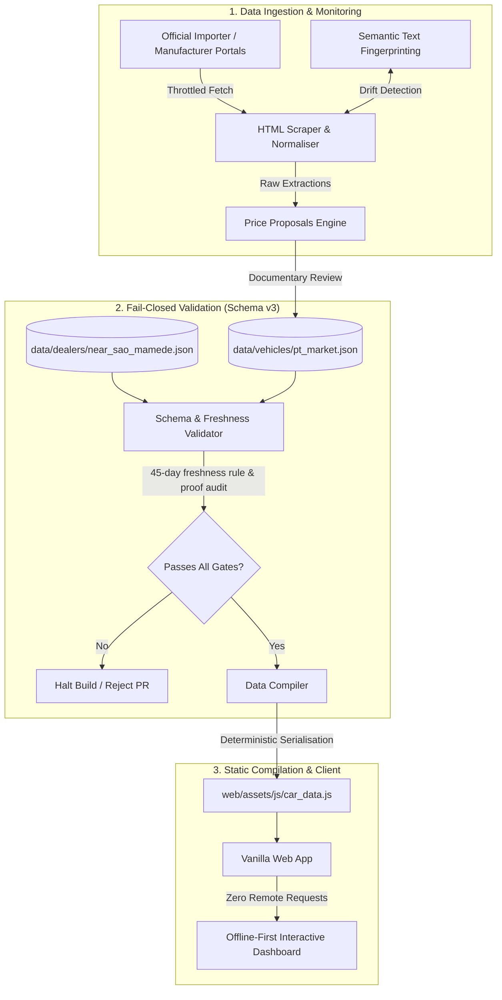

# Portugal EV Market Guide

[](https://github.com/oarguido/portugal-ev-market-guide/actions/workflows/ci.yml)
[](https://github.com/oarguido/portugal-ev-market-guide/actions/workflows/data-health.yml)
[](LICENSE)
[](pyproject.toml)
[](tests/)
[](web/)

An automated, evidence-backed data pipeline, validation harness, and offline-first decision dashboard for the Portuguese 100% electric passenger vehicle (BEV) market under the national **€40,000** incentive threshold.

> [!NOTE]
> Para a documentação original em Português de Portugal, consulte [README.pt.md](README.pt.md). O contrato operacional de desenvolvimento com agentes de IA está documentado em [AGENTS.md](AGENTS.md).

---

## 🎯 Motivation & Problem

Navigating electric vehicle acquisitions in Portugal is notoriously difficult:
* **Fragmented & deceptive pricing:** Commercial discounts, business-only leasing offers without VAT, and trade-in gimmicks are routinely presented to retail consumers as "MSRP".
* **Regulatory thresholds:** The national Portuguese environmental subsidies and tax brackets strictly cap passenger vehicle incentives at **€40,000 (including 23% VAT)**.
* **Hybrid noise:** Portals often bundle Mild Hybrids (MHEV), Plug-in Hybrids (PHEV), and Range Extenders (REEV) under "electrified" banners.

This project solves that by applying rigorous software and data engineering practices: building a continuous, deterministic data product where **every price, battery chemistry, and range metric must carry verifiable cryptographic or literal documentary proof** before being compiled.

---

## 🏛️ System Architecture

The project operates as an offline-first, fail-closed data product with zero runtime dependencies.



---

## 🔬 Core Engineering Highlights

### 1. Evidence-Backed Pricing Engine (Schema v3)
Unlike scrapers that parse arbitrary floats, every pricing entry requires a strict contractual schema:
* **Audience separation:** Only verified `private` (consumer) offers count towards budget eligibility. Business-only or unstated audiences are flagged and rejected from the confirmed tier.
* **Deterministic VAT:** Prices without VAT are rejected unless deterministically derivable with exact Portuguese tax rules and recorded with an explicit `derivation` record.
* **Literal excerpts:** Every confirmed offer maintains a `literal_excerpt` taken directly from the official manufacturer configurator or campaign document, stamped with `recorded_on` and `verified_on`.

### 2. Fail-Closed Validation & Circuit Breakers
* **45-Day Freshness Gate:** If an offer’s proof or a dealer’s confirmation exceeds 45 days, the compiler trips a circuit breaker and fails the build. Stale data is never published as current.
* **Strict Powertrain Filter:** Homologation M1 passenger BEVs only. PHEVs, commercial N1 vans, or concept cars fail schema validation automatically.
* **Image Byte Budget:** Local official imagery is required for every model and constrained to `< 500 KB` per asset and `< 12 MB` total, enforced via automated budgeting checks.

### 3. CI/CD & Observability
* **PR Verification (`ci.yml`):** Runs linting (`ruff`), schema validation, data compilation, and the full test suite (185 Python tests + 73 JavaScript tests). Confirms that the compiled bundle matches the JSON truth.
* **Weekly Automated Data Health (`data-health.yml`):** A scheduled workflow runs every Monday at 06:00 UTC to crawl all registered manufacturer links, check semantic drift, and **automatically create or update a GitHub Issue** labeled `dados-frescura` if external URLs break or prices change.

### 4. Zero-Dependency, Offline-First Client
* Built with pure HTML5, modern vanilla ECMAScript (ESM), and CSS tokens.
* **Offline capability:** All datasets, icons, and vehicle imagery are packaged locally. Zero remote CDNs or tracking pixels.
* **Strict security boundaries:** Hand-crafted escaping layer ([`web/assets/js/html.js`](web/assets/js/html.js)) sanitises all dynamic catalog content prior to DOM interpolation, preventing XSS even with rogue scraped content.

### 5. AI-Native Operational Runbook
The repository contains an authoritative machine runbook ([`AGENTS.md`](AGENTS.md)) designed for autonomous AI agents (Claude, DeepMind Antigravity, etc.). It establishes explicit protocols for market discovery, photographic audits, geographical dealership proximity checks, and human sign-off boundaries.

---

## 📊 Catalog Overview

* **Eligible Cohort:** Confirmed passenger BEVs with official Portuguese MSRP ≤ €40,000 (VAT included).
* **Reference Cohort:** Models with published pricing indications under investigation, clearly labeled as `Reference (Unconfirmed VAT / Audience)` and excluded from eligibility rankings.
* **Dealership Benchmarking:** Exactly one official dealership per active brand, benchmarked against Greater Porto (Metropolitan Area) to verify real service and parts availability.

---

## 🛠️ Developer & Operational Guide

The project uses a standard `Makefile` for zero-friction workflows:

### Quickstart

```sh
# Clone repository
git clone https://github.com/oarguido/portugal-ev-market-guide.git
cd portugal-ev-market-guide

# Start local offline server (auto-detects open port starting at 8000)
make serve
```

Or simply open `web/index.html` directly in any modern browser.

### Test & Validation Commands

```sh
make lint            # Static analysis with ruff (pinned via uv)
make validate        # Fail-closed schema v3 validation and compilation (offline)
make test            # Executes 185 Python unit tests and 73 Node.js test-runner tests
make links           # Concurrency-throttled crawler validating all external URLs
make freshness       # Verifies that no catalog records exceed the 45-day threshold
make budgets         # Enforces photo weight budget limits (<500 KB per photo)
make audit           # Full suite: lint, validate, freshness, tests, and link audit
```

### Data Pipeline Commands

```sh
make update          # Monitors official portals, detects semantic changes, updates proposals
make update-accept   # Accepts updated source fingerprints after explicit human review
make expire-campaigns # Marks expired promotional campaigns as reference offers
```

---

## 📁 Repository Structure

```text
├── data/
│   ├── vehicles/pt_market.json      # Single source of truth for vehicles (Schema v3)
│   ├── dealers/near_sao_mamede.json # Dealerships benchmarked by regional proximity
│   └── source_snapshots.json        # Semantic text fingerprints of official sources
├── scripts/
│   ├── compile_data.py              # Compiles JSON into web-ready static bundle
│   ├── validate_data.py             # Fail-closed Schema v3 validator & freshness guards
│   ├── update_catalog.py            # Automated source monitoring & fingerprinting
│   ├── refresh_prices.py            # Price proposal extractor
│   └── expire_campaigns.py          # Automatic campaign validity lifecycle manager
├── tests/
│   ├── test_schema_v3.py            # Contract tests for vehicle schemas
│   ├── test_validate_guards.py      # Circuit-breaker and validation tests
│   └── prices.test.js               # Pricing logic and eligibility unit tests
├── web/
│   ├── index.html                   # Interactive offline-first dashboard
│   ├── assets/js/                   # Vanilla JavaScript modules (HTML, search, ranking)
│   └── assets/images/vehicles/      # Budget-optimised local vehicle imagery
├── AGENTS.md                        # Autonomous AI agent operational runbook
├── README.pt.md                     # Original Portuguese technical documentation
└── pyproject.toml                   # Project metadata and tooling configuration
```

---

## 📄 License & Attribution

* Original code and documentation are released under the [MIT License](LICENSE).
* Vehicle photographs, brand names, and trademarks belong to their respective manufacturers; see [ASSET_NOTICE.md](ASSET_NOTICE.md) for fair-use editorial disclosure and asset licensing.
