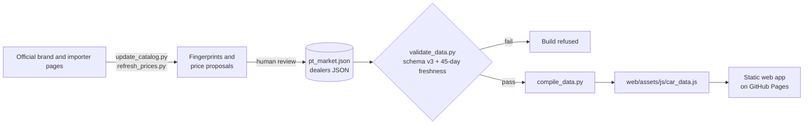

# Portugal EV Market Guide

[](https://github.com/oarguido/portugal-ev-market-guide/actions/workflows/ci.yml)
[](https://github.com/oarguido/portugal-ev-market-guide/actions/workflows/data-health.yml)
[](LICENSE)
[](pyproject.toml)

**An evidence-backed data pipeline and offline dashboard for every new battery-electric car sold in Portugal for up to €40,000.**

**Live site:** https://oarguido.github.io/portugal-ev-market-guide/ (interface in Portuguese)

> [!NOTE]
> Documentação em Português de Portugal: [README.pt.md](README.pt.md). The operating contract for AI coding agents working on this repository is [AGENTS.md](AGENTS.md).

---

## Why it exists

Buying an electric car in Portugal under the €40,000 (VAT included) incentive threshold is harder than it should be:

- **Prices are hard to compare.** Campaign discounts, business-only offers quoted without VAT, and trade-in conditions are often presented alongside the retail list price.
- **"Electrified" is not electric.** Market portals mix mild hybrids, plug-in hybrids and range extenders with battery-electric cars.
- **Information goes stale.** Campaigns end and configurators change without notice.

This project treats the catalogue as a data product: every price must carry a source URL, a literal excerpt from the official page and a verification date, and the build refuses to publish data that is invalid or older than 45 days.

## What it does

- **Curated catalogue** of 62 battery-electric passenger models (59 confirmed under €40,000, 3 kept as unconfirmed references; last full verification 2026-09-02) in a single JSON source of truth, `data/vehicles/pt_market.json`.
- **Fail-closed validation (schema v3).** Only private-buyer, VAT-inclusive prices count towards eligibility; prices without VAT are accepted only with an explicit derivation record; non-BEV powertrains are rejected.
- **Freshness gate.** Proofs and dealer confirmations older than 45 days, or expired campaigns, fail validation, and the compiler then refuses to write the web bundle.
- **Source monitoring.** Official pages are fingerprinted (SHA-256 of normalised visible text, stored in `data/source_snapshots.json`). A change produces a review proposal in `data/price_proposals.json`, never a silent edit; accepting new fingerprints is an explicit human step.
- **Offline, dependency-free web app.** Plain HTML, vanilla JavaScript modules and CSS; all data, icons and images are bundled locally, with no CDN or tracking. Dynamic content is escaped through a single helper, [`web/assets/js/html.js`](web/assets/js/html.js).
- **Four views:** our three finalists, market overview with search and ranking, a technical comparator, and test-drive and dealer planning (one official dealer per brand, nearest to a reference location in Greater Porto).
- **Automation.** CI runs lint, validation, compilation and the test suite on every push and pull request, and checks that the committed bundle matches the JSON. A weekly scheduled job re-runs validation, freshness and link checks and opens or updates a GitHub issue when the data needs review. GitHub Pages deploys the `web/` folder.

## Architecture



## Tech stack

- **Pipeline:** Python 3.13, standard library only (no runtime dependencies); `ruff` pinned as the only dev tool, managed with `uv`.
- **Browser automation:** the external `agent-browser` CLI, used by the price, discovery and photo scripts for pages that need JavaScript.
- **Front end:** HTML5, vanilla ES modules, CSS custom properties, vendored Font Awesome.
- **Tests:** Python `unittest` (185 tests) and the Node.js built-in test runner (73 tests).
- **CI/CD:** GitHub Actions (validation, weekly data health, Pages deploy) and Dependabot.

## Run it locally

Requirements: Python 3.13+, Node.js 22+ (tests only), `uv` (lint only).

```sh
git clone https://github.com/oarguido/portugal-ev-market-guide.git
cd portugal-ev-market-guide

make serve        # serves web/ on http://localhost:8000 (next free port if taken)
```

You can also open `web/index.html` directly in a browser.

### Checks (offline)

```sh
make lint         # ruff
make validate     # schema v3 validation, then compile the web bundle
make test         # Python unittest + Node.js tests
make verify       # lint, validate, compile, tests and pending report (what CI runs)
make freshness    # global 45-day freshness and expired-campaign check
make budgets      # image size budgets
```

The freshness gate depends on today's date, so `make validate` and `make verify` start failing once the catalogue goes more than 45 days without re-verification or a campaign expires. That is intended: stale data is never published as current.

### Data maintenance (network)

```sh
make links             # check every external URL
make update            # full refresh: fingerprints, model discovery, prices, photos, campaigns, images, validation, tests
make update-accept     # accept changed source fingerprints after human review
```

`make update` needs `agent-browser` on the `PATH`.

## Project structure

```text
data/
  vehicles/pt_market.json       # catalogue: single source of truth (schema v3)
  dealers/near_sao_mamede.json  # one official dealer per brand
  source_snapshots.json         # SHA-256 fingerprints of official sources
  price_proposals.json          # proposals awaiting human review
scripts/
  validate_data.py              # fail-closed validator, freshness, links, budgets
  compile_data.py               # JSON -> web/assets/js/car_data.js
  update_catalog.py             # source monitoring and fingerprinting
  refresh_prices.py             # price and campaign proposals from official pages
  discover_models.py            # market radar for new models
  expire_campaigns.py           # campaign lifecycle
  capture_photos.py, optimize_images.py, archive_unused_images.py
  serve.py                      # local static server
tests/                          # Python and Node.js test suites
web/
  index.html                    # the dashboard
  assets/js/                    # app, search, ranking, prices, finalists, HTML escaping
  assets/images/vehicles/       # local official imagery
AGENTS.md                       # runbook for AI coding agents
README.pt.md                    # Portuguese documentation
```

## Author and licence

Built by **André Lima**, AI/Data Engineer.

- Code and documentation: [MIT Licence](LICENSE).
- Vehicle photographs, brand names and trademarks belong to their owners; see [ASSET_NOTICE.md](ASSET_NOTICE.md).
- Not affiliated with any manufacturer or importer. Prices are informative; always confirm with the official dealer.
